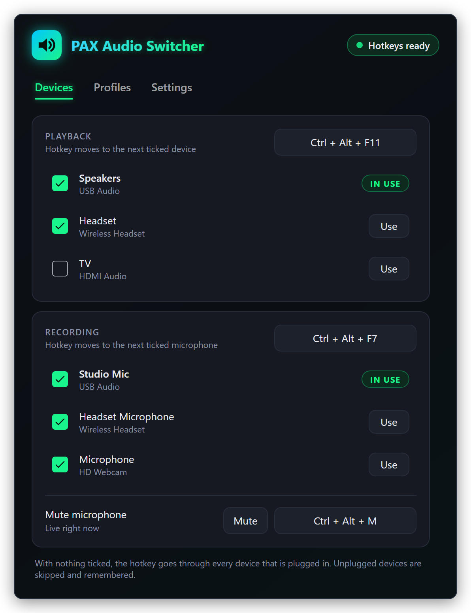
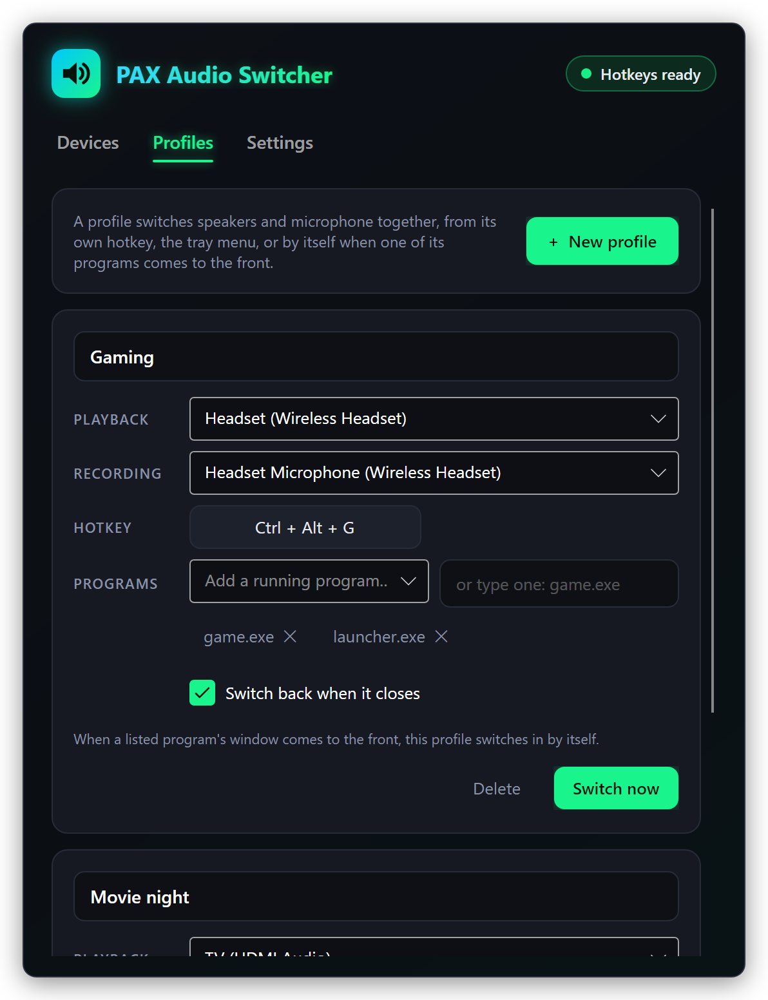
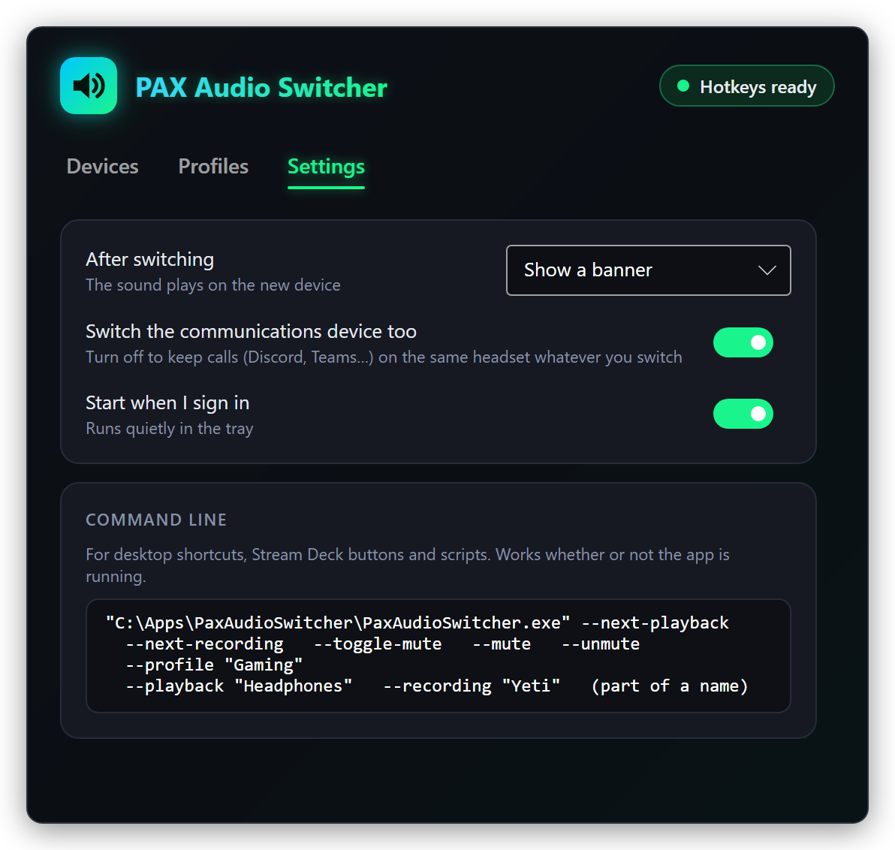
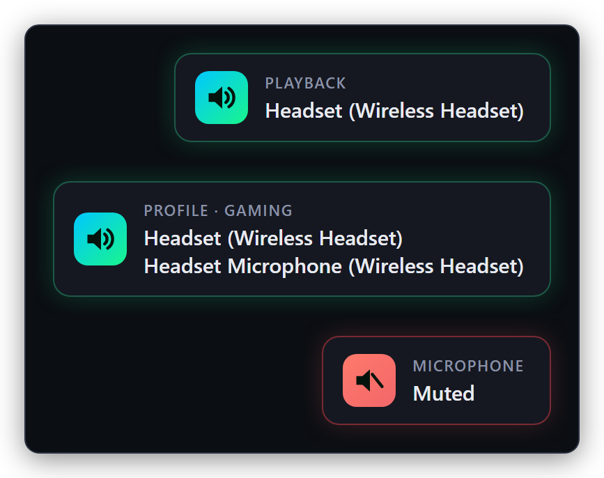

# PAX Audio Switcher

**Switch speakers, headset and microphone with one key.** A small Windows tray app: press a hotkey to move to the next playback or recording device, switch a whole setup with a profile, or let a profile kick in by itself when a game or call app comes to the front.

<p align="center">
  
</p>

## Features

- **Cycle hotkeys.** <kbd>Ctrl</kbd> + <kbd>Alt</kbd> + <kbd>F11</kbd> steps through playback devices and <kbd>Ctrl</kbd> + <kbd>Alt</kbd> + <kbd>F7</kbd> through microphones. Tick the devices you actually use; the rest are skipped. Unplugged devices are skipped too, and remembered for when they come back.
- **Microphone mute** on its own hotkey (<kbd>Ctrl</kbd> + <kbd>Alt</kbd> + <kbd>M</kbd>), from the tray menu, or with the button in the window.
- **Pick any device directly** with its **Use** button, or from the tray menu.
- **Profiles.** A playback and microphone pair (either side can be "leave as it is") with its own hotkey.
- **Follow programs.** List programs in a profile (`game.exe`, `discord.exe`…). When one of their windows comes to the front, the profile switches in; with *Switch back when it closes*, your previous devices come back once every listed program has closed.
- **Feedback** after each switch: a small banner in the bottom-right corner that never steals focus, a sound played on the new device, both, or nothing.
- **Communications device** can switch along with the default one, or stay put so calls keep using the same headset.
- **Command line** for desktop shortcuts, Stream Deck buttons and scripts. Works whether the app is running or not.
- **Hotkey clash warning** when another program already owns a combination.
- **Light.** The settings window only exists while it is open; nothing polls in the background.
- **Start when I sign in**, optional.

| Profiles | Settings |
| --- | --- |
|  |  |

The banner after a switch, a profile and a mute:

<p align="center">
  
</p>

## How it works

- **Devices.** The Windows Core Audio API (`IMMDeviceEnumerator`) lists playback and recording devices and reports when one is plugged in, removed or changed.
- **Switching.** The default device is set through `IPolicyConfig`, the interface Windows' own Sound control panel uses. It isn't officially documented, so a future Windows update could change it. Each switch sets the *Console* and *Multimedia* roles, and *Communications* too unless you turn that off.
- **Hotkeys** are registered with `RegisterHotKey` on a hidden message-only window: no keyboard hook, nothing reads your typing.
- **Programs.** Profiles that follow programs use an out-of-context WinEvent hook for "foreground window changed", so nothing is injected into other programs and nothing polls. The watcher only runs while some profile has programs listed.
- **Command line.** A second copy started with options hands them to the running copy over a named pipe and exits. If no copy is running, it does the job itself and exits.

It was written from scratch and shares no code with other audio switchers.

## Supported systems

| System | Status | Notes |
| --- | --- | --- |
| Windows 11, x64 | **Tested** | In daily use. |
| Windows 10, x64 | Should work, untested | Uses the same audio interfaces as Windows 11. |
| Windows on Arm | No download | May build from source with `-r win-arm64`; untested. |
| Linux, macOS | **Not supported** | The app is built on Windows-only audio and hotkey APIs. |

## Install (Windows)

1. Install the **[.NET 10 Runtime](https://dotnet.microsoft.com/download/dotnet/10.0)** (x64) if you don't have it. The plain ".NET Runtime" is enough; the ".NET Desktop Runtime" includes it, so that works too.
2. Download **`PaxAudioSwitcher-1.0.0-win-x64.zip`** from **[the latest release](https://github.com/joshpack/PaxAudioSwitcher/releases/latest)** (and `PaxAudioSwitcher-1.0.0-win-x64.zip.sha256` if you want to check it: `Get-FileHash PaxAudioSwitcher-1.0.0-win-x64.zip` in PowerShell).
3. Unzip it somewhere permanent, for example `%USERPROFILE%\Apps\PaxAudioSwitcher`.
4. Run `PaxAudioSwitcher.exe`. It doesn't need administrator rights.

The exe isn't code-signed, so SmartScreen may warn the first time: choose **More info → Run anyway**.

## First run

- The settings window opens and a speaker icon appears in the tray. Hover it to see the current playback device and microphone.
- **Click the tray icon** to open the settings. **Right-click** it for *Playback* and *Recording* submenus (pick any device), *Profiles*, *Mute microphone*, *Settings…* and *Quit*.
- Closing the window keeps the hotkeys working from the tray. *Quit* stops them.
- On the **Devices** tab, untick devices you never want the hotkey to land on. With everything ticked, the hotkey goes through every device that is plugged in, including ones you add later.
- To change a hotkey, click it and press the new combination. <kbd>Esc</kbd> cancels, <kbd>Backspace</kbd> removes the hotkey. Your other hotkeys are paused while you do this.
- If the status in the top-right corner says **hotkey blocked**, another program owns that combination; pick a different one.
- Switch on **Start when I sign in** (Settings tab) to start with Windows. It then starts quietly in the tray and only opens the window when a hotkey couldn't be registered. This adds the value `PaxAudioSwitcher` under `HKCU\Software\Microsoft\Windows\CurrentVersion\Run`.

## Hotkeys

| Default | What it does |
| --- | --- |
| <kbd>Ctrl</kbd> + <kbd>Alt</kbd> + <kbd>F11</kbd> | Next playback device |
| <kbd>Ctrl</kbd> + <kbd>Alt</kbd> + <kbd>F7</kbd> | Next microphone |
| <kbd>Ctrl</kbd> + <kbd>Alt</kbd> + <kbd>M</kbd> | Mute or unmute the microphone |
| *(none)* | Each profile can have its own |

All of them can be changed or removed. A hotkey needs at least one of Ctrl, Alt, Shift or Win, except keys nobody types by accident: F13 to F24, the media and volume keys, Pause and Scroll Lock.

## Command line

```bat
PaxAudioSwitcher.exe --next-playback
PaxAudioSwitcher.exe --profile "Gaming"
PaxAudioSwitcher.exe --playback "headset" --recording "studio"
```

| Option | What it does |
| --- | --- |
| `--next-playback` | Next playback device in the cycle |
| `--next-recording` | Next microphone in the cycle |
| `--playback "text"` | Switch to the first playback device whose name contains *text* |
| `--recording "text"` | Same for microphones |
| `--profile "Name"` | Switch to a profile |
| `--toggle-mute`, `--mute`, `--unmute` | Microphone mute |
| `--show` | Open the settings window of the running copy |
| `--minimized` | Start in the tray without opening the window |
| `--self-test <folder>` | Diagnostics, see below |

Options can be combined. When the app is already running they are passed to it; otherwise the command does the job and exits with code 0, or 1 if something couldn't be done (no such profile, no matching device).

## Settings file

Everything is saved as JSON in `%APPDATA%\PaxAudioSwitcher\settings.json`: the hotkeys, which devices are in each cycle (`PlaybackCycle`, `RecordingCycle`; empty means all), `SetCommunications`, `Notify` (`Banner`, `BannerAndSound`, `Sound` or `Off`), the profiles, and the last-known name of every device (so a profile can still name a device that is unplugged). Delete the file to go back to the defaults.

## Self-test

```bat
PaxAudioSwitcher.exe --self-test C:\Temp\pax-test
```

Writes `report.txt` into that folder: the devices it found, whether re-applying the current defaults works (the defaults are set to what they already are, so nothing audibly changes), and which hotkeys are free. It also saves `tab0.png` to `tab2.png`, pictures of the settings window drawn off-screen, so nothing appears on your screen. The report and pictures contain your real device names.

## Uninstall

1. On the Settings tab, switch off **Start when I sign in**.
2. Right-click the tray icon → **Quit**.
3. Delete the app folder and `%APPDATA%\PaxAudioSwitcher`.

## Build from source

Windows with the [.NET 10 SDK](https://dotnet.microsoft.com/download/dotnet/10.0):

```bash
git clone https://github.com/joshpack/PaxAudioSwitcher.git
cd PaxAudioSwitcher
dotnet run
dotnet publish -c Release -r win-x64 --self-contained false -p:DebugType=none -o publish/win-x64
```

The version comes from `<Version>` in `PaxAudioSwitcher.csproj`. For a copy that doesn't need the .NET Runtime installed, use `--self-contained true` (a bigger download).

## Code layout

| Path | What's there |
| --- | --- |
| `Program.cs` | Start-up, single instance, forwarding options to the running copy, the command-line actions |
| `App.axaml(.cs)` | Theme, tray icon and menu, listening for forwarded commands |
| `Audio/CoreAudio.cs` | Core Audio and `IPolicyConfig` COM interop |
| `Audio/AudioDevices.cs` | Listing devices, reading and setting defaults, microphone mute, change notifications |
| `Platform/Hotkeys.cs` | Global hotkeys on a message-only window |
| `Platform/ForegroundWatcher.cs` | Which program's window is in front |
| `Platform/MemoryTrim.cs` | Hands unused memory back to Windows after the window closes |
| `Services/Switcher.cs` | Cycling, profiles, mute, following programs and switching back |
| `Services/AppSettings.cs` | Settings and profiles |
| `Services/Autostart.cs` | Start at sign-in |
| `Views/SettingsWindow.axaml(.cs)` | The settings window |
| `Views/HotkeyButton.cs` | Click-and-press hotkey picker |
| `Views/Banner.cs` | The corner banner |
| `AppIcon.cs` | The app and tray icons, drawn in code |
| `SelfTest.cs` | `--self-test` |
| `docs/screenshots/` | The pictures in this file |

Built with [Avalonia](https://avaloniaui.net/) 12 on .NET 10.
